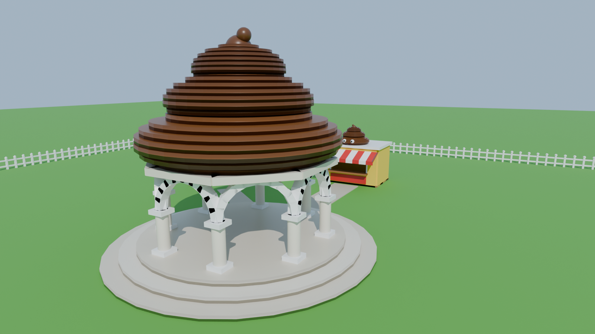
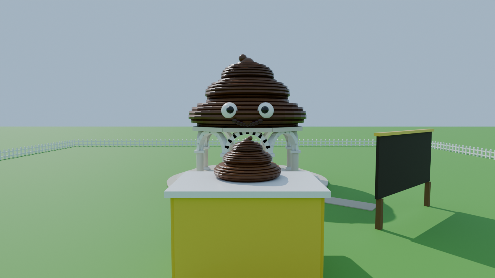
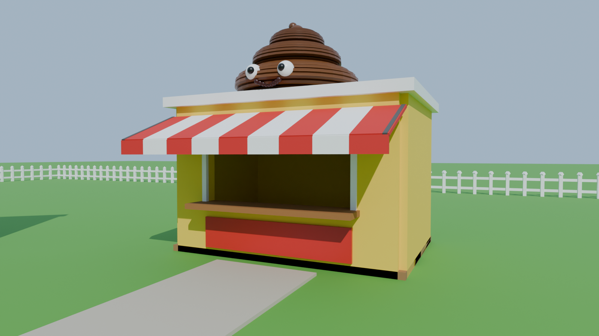
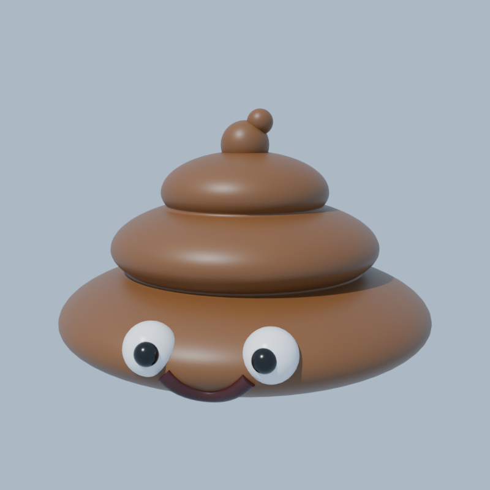

# 💩 Sell the Poop

Versión con caca de *Sell Lemons 🍋* (Roblox). Haz caca, véndela, compra mejoras, acepta tratos de un comprador misterioso y reinicia con el **Laxante Cósmico** para multiplicar todo.

## Qué incluye

- **Hacer caca** con un botón (+caca por click): tu personaje se agacha y suelta una cacotita.
- **Vender** solo en la ventanilla de la tienda (tecla E).
- **Tienda de mejoras**: 💪 Intestino Fuerte (más caca por click), ✨ Caca Premium (+25% precio), 🚽 Váter Automático (caca por segundo).
- **Tratos** 👽: cada 1–2 minutos un comprador ofrece x2–x5 durante 30 s.
- **Rebirth** 🌌 Laxante Cósmico: reinicia dinero y mejoras, +x1 permanente a todo.
- **Ganancias offline** al 100% (hasta 24 h) y **guardado automático** con DataStore.
- Leaderboard con Cash, Poop y Rebirths, y un **cartel en el mapa** con el top 10 de más dinero, más caca producida y más clicks (global si el lugar está publicado). Anti-autoclicker básico.

## Mapa

Se construye por código al darle a Play (`src/server/Map.luau`): césped con valla blanca, spawn redondo con 3 escalones y 8 arcos con una cúpula que es una caca enorme con cara, tienda de ventanilla amarilla con toldo de mercadillo y caca en el techo, y el cartel del ranking.





## Modelo de Blender (opcional)

`blender/caca_gigante.py` genera una caca con cara lisa (`blender/CacaGigante.fbx`). Si la importas, el mapa la usa en vez de la caca de bloques:

1. En Studio: **Archivo → Importar 3D** y elige `blender/CacaGigante.fbx`.
2. Mueve el modelo importado a **ReplicatedStorage**, dentro de una carpeta llamada `Assets`, y llámalo `CacaGigante`.
3. Pulsa Play: la cúpula y la caca de la tienda usarán ese modelo (se escala y se gira solo).



Todos los números (precios, multiplicadores, tiempos) están en `src/shared/Config.luau`.

## Estructura

```
src/shared/Config.luau          -> ReplicatedStorage/Shared/Config   (ModuleScript)
src/server/Main.server.luau     -> ServerScriptService/Server/Main   (Script)
src/server/Map.luau             -> ServerScriptService/Server/Map    (ModuleScript)
src/server/Crouch.luau          -> ServerScriptService/Server/Crouch (ModuleScript)
src/server/Leaderboard.luau     -> ServerScriptService/Server/Leaderboard (ModuleScript)
src/client/UI.client.luau       -> StarterPlayer/StarterPlayerScripts/Client/UI (LocalScript)
default.project.json            -> proyecto de Rojo
```

## Opción A: con Rojo (recomendado)

1. Instala Rojo (https://rojo.space) y el plugin de Rojo en Roblox Studio.
2. En esta carpeta: `rojo serve`
3. En Studio, abre un Baseplate, pulsa **Connect** en el plugin de Rojo.

## Opción B: a mano en Roblox Studio

1. Abre un **Baseplate** nuevo.
2. En **ReplicatedStorage** crea una **Folder** llamada `Shared` y dentro un **ModuleScript** llamado `Config`. Pega `src/shared/Config.luau`.
3. En **ServerScriptService** crea una **Folder** llamada `Server`. Dentro, un **Script** llamado `Main` (pega `src/server/Main.server.luau`) y tres **ModuleScript** llamados `Map`, `Crouch` y `Leaderboard` con sus archivos.
4. En **StarterPlayer > StarterPlayerScripts** crea un **LocalScript** y pega `src/client/UI.client.luau`.
5. Para que se guarde el progreso en Studio: **Game Settings > Security > Enable Studio Access to API Services** (el juego tiene que estar publicado).
6. Pulsa **Play**.
